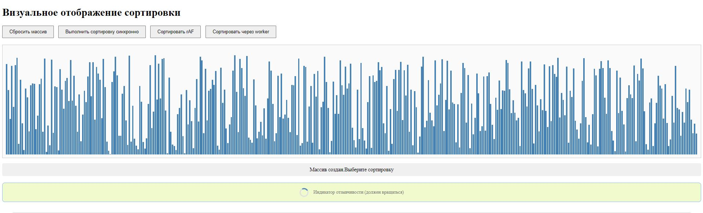

# Sorting Visualiser

Интерактивный визуализатор сортировки на JavaScript, демонстрирующий работу алгоритма сортировки и разные подходы к выполнению тяжелых вычислений в браузере: синхронно, через `requestAnimationFrame` и в `Web Worker`.

## Скриншот

## Возможности

- Генерация случайного массива и его визуализация в виде столбцов.
- Три режима сортировки одного и того же массива:
  - **Синхронно** - блокирует Event Loop и заставляет UI "замерзнуть"(подвисает) .
   - **Через `requestAnimationFrame`** анимированная сортировка по шагам, UI остается отзывчивым.
   - **Через `Web Worker`** - вычисления в фоновом потоке , UI полностью свободен.
- Индикатор отзывчивости интерфейса (спинер, который вращается через JavaScript) - наглядно показывает блокировку основного потока.
- Замер и отображение времени выполнения каждого режима.

## Технологический стек
- HTML5
- CSS3
- JavaScript
- ES Modules
- Web Worker API
-requestAnimationFrame

## Что демонстрирует проект
- Архитектуру приложения на нативных **ES Modules**.
- Работу с **DOM** и эффективный рендеринг большого числа элементов.
- Влияние **синхронных вычислений** на отзывчивость интерфейса и блокировку **Event loop**.

## Лицензия
 Проект распространяется под лицензией [MIT](./LICENSE)
 

